# Employee Attrition Analysis

An exploratory data analysis (EDA) project using a sample HR employee dataset. The notebook inspects the data, summarizes employee and job attributes, explores attrition patterns, creates visualizations, encodes categorical columns, and demonstrates Min-Max scaling.

> This repository contains exploratory analysis and preprocessing only. It does not train or evaluate an employee-attrition prediction model.

## Project overview

The included CSV has **1,470 employee records** and **35 columns**. In this dataset, 237 records have `Attrition = Yes` (about **16.1%**) and 1,233 have `Attrition = No`. No empty cells were found in the supplied CSV during the project review.

The data describes sample employee demographics, job roles, satisfaction measures, compensation, tenure, and attrition. It is suitable for demonstrating data analysis workflows; it should not be used to make real employment decisions.

## Analysis covered

- Inspect rows, columns, data types, and descriptive statistics
- Check for missing values and review value distributions
- Group and aggregate employee data by age, department, job role, and other categories
- Explore attrition and compensation patterns
- Create charts with Matplotlib and Seaborn
- Encode selected categorical columns and one-hot encode categories
- Apply `MinMaxScaler` to numeric columns in the encoded dataset

Visualizations in the notebook include employee age distribution, average monthly income by job role, department/satisfaction heatmaps, attrition distribution, and compensation comparisons.

## Libraries

- **pandas** - loading and manipulating tabular data
- **NumPy** - numerical operations
- **Matplotlib** - plotting
- **Seaborn** - statistical visualizations
- **scikit-learn** - Min-Max feature scaling
- **Jupyter** - interactive notebook environment

## Visualization gallery

When the notebook is run, each chart is saved as a 300-DPI PNG under `visualizations/` as well as displayed in the notebook.

| Chart | Preview |
| --- | --- |
| Employee age distribution | 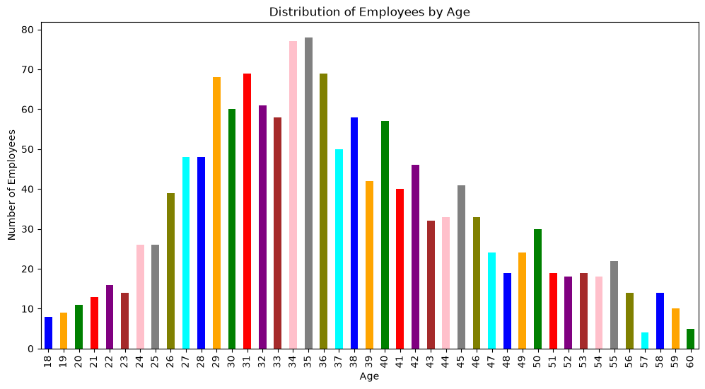 |
| Average monthly income by job role | 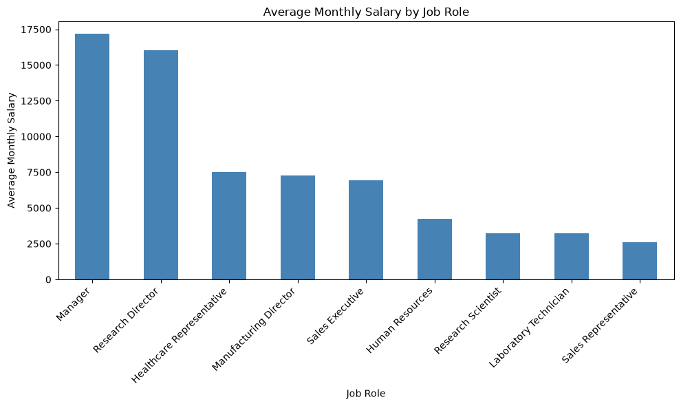 |
| Average salary by department and job satisfaction | 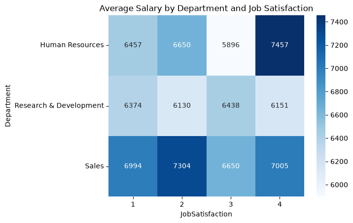 |
| Age vs. monthly income by attrition | 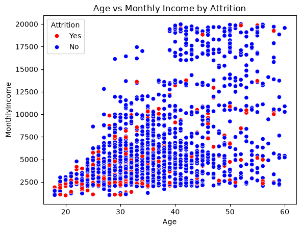 |
| Company experience vs. monthly income | 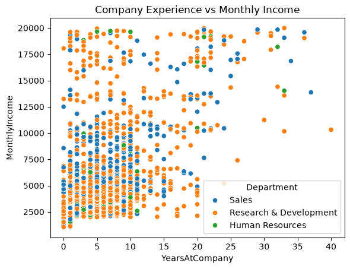 |
| Company experience vs. monthly income (Set2 palette) | 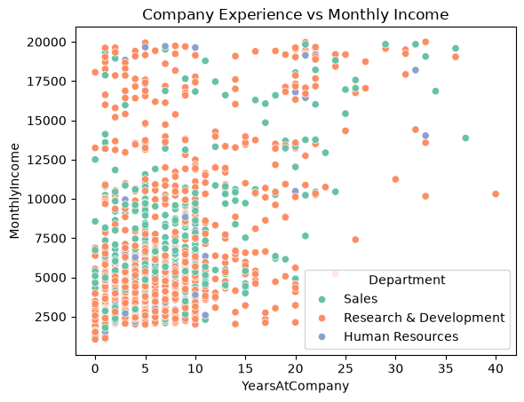 |
| Age vs. total working experience | 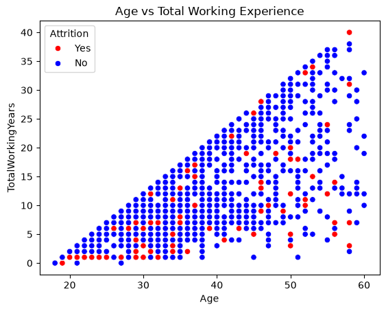 |
| Employee attrition distribution | 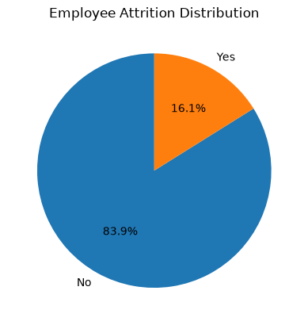 |
| Salary distribution by attrition |  |
| Salary distribution by attrition (repeat) | 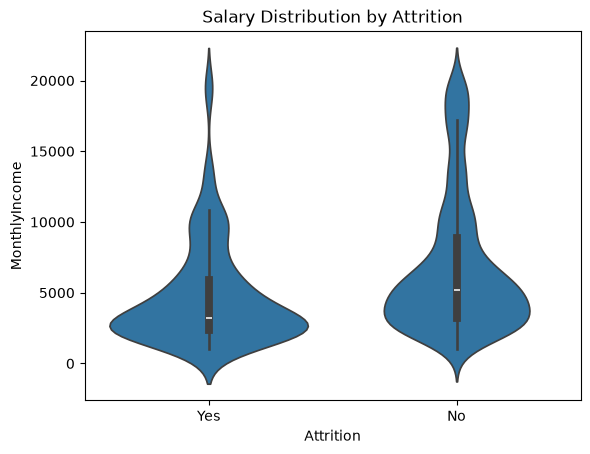 |
| Salary distribution by attrition (repeat) |  |
| Average salary by years at company | 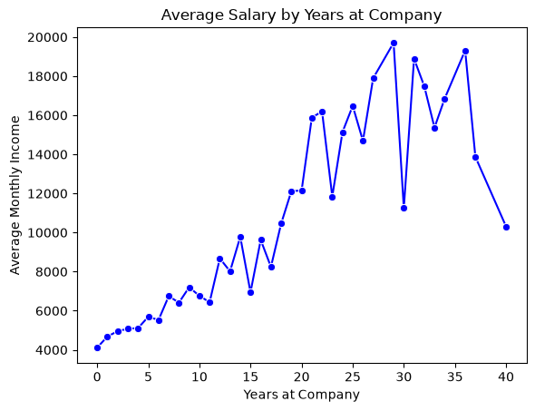 |
| Salary by job satisfaction | 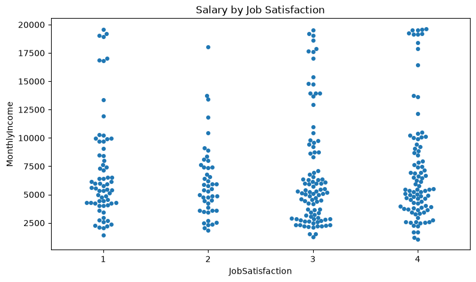 |

## Repository contents

| File | Description |
| --- | --- |
| `employee-attrition-analysis.ipynb` | Main notebook with EDA, charts, encoding, and scaling |
| `WA_Fn-UseC_-HR-Employee-Attrition.csv` | Dataset used by the notebook |
| `visualizations/` | PNG exports generated when chart cells run |
| `requirements.txt` | Python package dependencies |
| `.gitignore` | Excludes virtual environments and local-generated files |

## Getting started

### Requirements

- Python 3.10 or newer
- Jupyter Notebook/Lab, or Visual Studio Code with the Python and Jupyter extensions

### Install dependencies

From the repository folder, create and activate a virtual environment:

```bash
python -m venv .venv
```

On Windows PowerShell:

```powershell
.\.venv\Scripts\Activate.ps1
```

On macOS/Linux:

```bash
source .venv/bin/activate
```

Install the packages:

```bash
python -m pip install --upgrade pip
pip install -r requirements.txt
```

### Run the notebook

Start Jupyter:

```bash
jupyter lab
```

Open `employee-attrition-analysis.ipynb` and run the cells from top to bottom. Keep the CSV in the repository folder because the notebook loads it using a relative path.

In Visual Studio Code, open the notebook, select the `.venv` Python kernel, and run the cells in order.

## Data notes and limitations

- The CSV is included as supplied with this project. Check its original source and usage terms before redistributing it elsewhere.
- This is sample HR data, not evidence about real employees or a particular organization.
- The analysis is descriptive and exploratory. Associations in these plots do not establish causation.
- Scaling is a preprocessing demonstration; scaling the entire dataset is not a substitute for fitting preprocessing on training data when building a predictive model.
- The notebook contains exploratory cells. Run them in order from a fresh kernel so later cells use the expected transformed dataframe.

## Suggested GitHub repository description

> Exploratory analysis of sample HR employee attrition data with Python, visualizations, categorical encoding, and Min-Max scaling.
